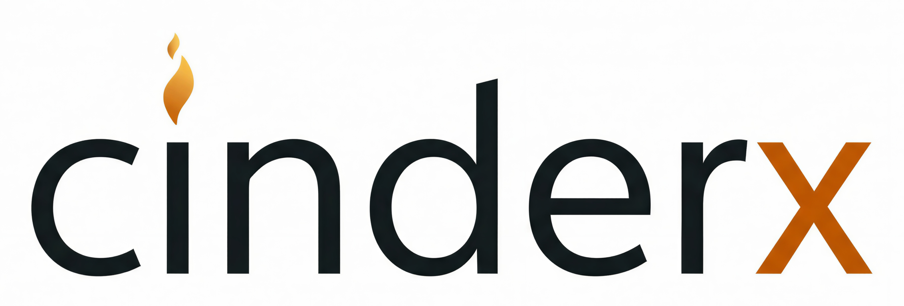

# CinderX

[](https://pypi.org/pypi/cinderx/)



CinderX is a Python extension that improves the performance of the Python
runtime.

## Status

CinderX is under active development.  It is used in production at Meta for
use-cases like the Instagram Django service.  It is **experimental** for
external users.  New releases are published to PyPI on a weekly basis.

## Features

- **JIT Compiler** - Just-in-time compilation of Python bytecode to native
  machine code
- **Static Python** - A stricter form/subset of Python, for type safety and
  optimization

The codebase includes other features as well, such as a parallel garbage
collector and a lighter weight implementation of Python interpreter frames.
However these features are not compatible with the stock CPython runtime yet.

## Requirements

- Python ≥3.14.5,<3.16
- GCC 13+ or Clang 18+

|         |        Linux       |        macOS       |       Windows      |
| ------- | ------------------ | ------------------ | ------------------ |
|  x86-64 | :white_check_mark: |         :x:        | :white_check_mark: |
| aarch64 | :white_check_mark: | :white_check_mark: |         :x:        |

## Installation

```bash
pip install cinderx
```

## Using the JIT

The recommended way to start using the JIT is to do:

```python
import cinderx.jit

cinderx.jit.auto()
```

This will configure the CinderX extension to automatically compile Python
functions to machine code.  It will track what functions are called frequently
and compile the hottest ones automatically.

See [the JIT documentation](https://facebookincubator.github.io/cinderx/jit) for
more details, or browse the full [CinderX documentation
site](https://facebookincubator.github.io/cinderx/).

### Native JIT with CPython's interpreter

On stock CPython 3.14 with the GIL and PEP 523 support, an opt-in startup
policy keeps CPython's evaluator for ordinary uncompiled functions while
retaining CinderX native JIT compilation:

```sh
CINDERX_INTERPRETER_MODE=cpython python application.py
```

```python
import cinderx
import cinderx.jit as jit

assert cinderx.get_interpreter_mode() == "cpython"
jit.enable()
jit.force_compile(python_function)
assert not cinderx.is_frame_evaluator_installed()
```

Set the environment variable before any import of CinderX, including imports
performed by startup hooks or dependencies. The policy is immutable for that
module lifetime; changing the environment after import does not change it.
The default, `CINDERX_INTERPRETER_MODE=cinderx`, preserves existing behavior.
`get_interpreter_mode()` reports the policy, while
`is_frame_evaluator_installed()` reports current evaluator ownership.

Manual compilation, lazy compilation, JIT lists, disable/enable cycles and
call-count automatic compilation retain the selected policy. In CPython mode,
`jit.auto()` uses its default call threshold only. Calls routed through the
JIT's scheduling adapter advance call counters; this is not a general counter
for every CPython frame. Existing and newly created eligible functions are
scheduled. Bytecode hotness is unavailable: explicit bytecode thresholds fail
without changing the scheduling configuration.

Static Python and CinderX-specific bytecodes require the default policy.
CPython mode skips CinderX's global opcode metadata initialization, disables
its specialized-opcode option, and rejects attempts to enable these features
or explicitly install the CinderX evaluator. The Static Python compiler/loader,
execution or construction of static/custom-code functions, and native
preloading/inlining of such code are rejected. Code compatibility checks are
cached per code object; ordinary calls do not repeatedly scan bytecode.

Foreign frame evaluators are preserved. A native CinderX entry still hands a
fresh frame to a foreign evaluator such as TorchDynamo when required. This
mode does not eliminate that handoff/materialization cost, accelerate GPU
kernels, or change the separately scoped generator/coroutine evaluator
limitations. Other Python versions, free-threaded builds and Meta Python are
not currently supported by this opt-in policy; the default remains available.

## CinderX vs Cinder

[Cinder](https://github.com/facebookincubator/cinder) was a fork of the CPython
runtime developed at Meta.  It included runtime optimizations (e.g. JIT) and was
specifically targeted at the Instagram Django codebase.  For Python 3.10, Meta
decided to turn it into a Python extension to improve compatibility with newer
Python versions.  This extension is now known as CinderX ("the X" is for
"extension").

Historically, for Python versions 3.10 through 3.12, CinderX depended on patches to
Meta's fork of the Python runtime.  Python 3.14 is the first version of stock
CPython that CinderX supports.

## License

CinderX is MIT licensed, see the LICENSE file.

## Terms of Use

https://opensource.fb.com/legal/terms

## Privacy Policy

https://opensource.fb.com/legal/privacy

---

Copyright © 2025 Meta Platforms, Inc.
